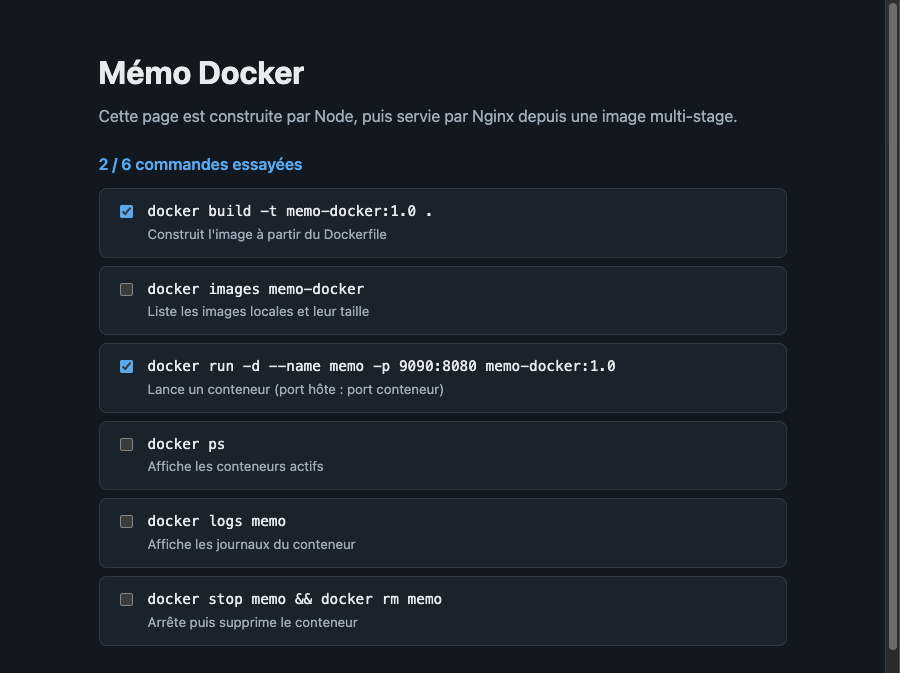

# TP Docker : image multi-stage

Application web simple, un aide-mémoire interactif des commandes Docker, créée avec React et Vite. Son build produit des fichiers statiques, servis par Nginx depuis une image Docker multi-stage.

## Structure

```text
.
├── app/            # Sources de l'application (React + Vite)
├── preuves/        # Sorties de commandes et capture d'écran
├── Dockerfile      # Build multi-stage
├── .dockerignore   # Fichiers exclus de l'image
└── .gitignore      # Fichiers exclus du dépôt
```

## L'image multi-stage

| Étape | Image de base | Rôle |
|---|---|---|
| `build` | `node:22-alpine` | Installe les dépendances avec `npm ci` et produit `dist/` |
| Finale | `nginxinc/nginx-unprivileged:1.28-alpine` | Sert uniquement le contenu de `dist/` |

- **Image légère :** Node, `node_modules` et les sources ne sont pas dans l'image finale.
- **Sans root :** Nginx tourne avec l'utilisateur `nginx` (uid 101) et écoute donc sur le port 8080.
- **Build reproductible :** les versions des images sont fixées (pas de `latest`) et `package-lock.json` verrouille les dépendances.
- **Cache efficace :** `package*.json` est copié avant le code, donc modifier le code ne relance pas l'installation des dépendances.

## Lancement

Prérequis : Docker (Docker Desktop ou Colima). Node n'est pas nécessaire sur le poste, car le build se fait dans l'image.

```bash
docker build -t memo-docker:1.0 .
docker run -d --name memo -p 9090:8080 memo-docker:1.0
```

L'application est ensuite disponible sur <http://localhost:9090>.

Pour arrêter et supprimer le conteneur :

```bash
docker stop memo && docker rm memo
```

## Tests

```bash
# Le conteneur tourne
docker ps --filter name=memo

# L'application répond (HTTP 200)
curl -i http://localhost:9090/

# Le conteneur ne tourne pas en root
docker exec memo id

# Node n'est pas dans l'image finale
docker exec memo sh -c "command -v node || echo node absent"
```

Dans le navigateur, la page affiche 6 commandes. Cocher une case met à jour le compteur `x / 6 commandes essayées`.

## Preuves de fonctionnement

| Fichier | Contenu |
|---|---|
| [`preuves/01-build.txt`](preuves/01-build.txt) | Sortie complète de `docker build` |
| [`preuves/02-tests.txt`](preuves/02-tests.txt) | Sorties des tests ci-dessus et test dans Chrome headless |


